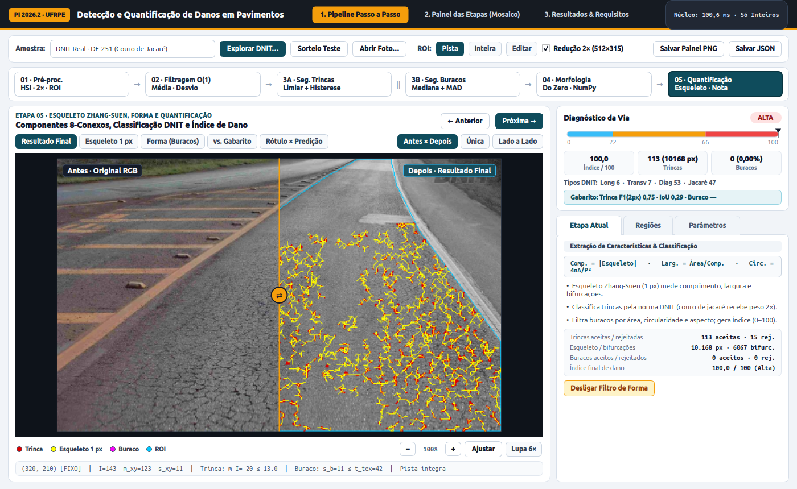
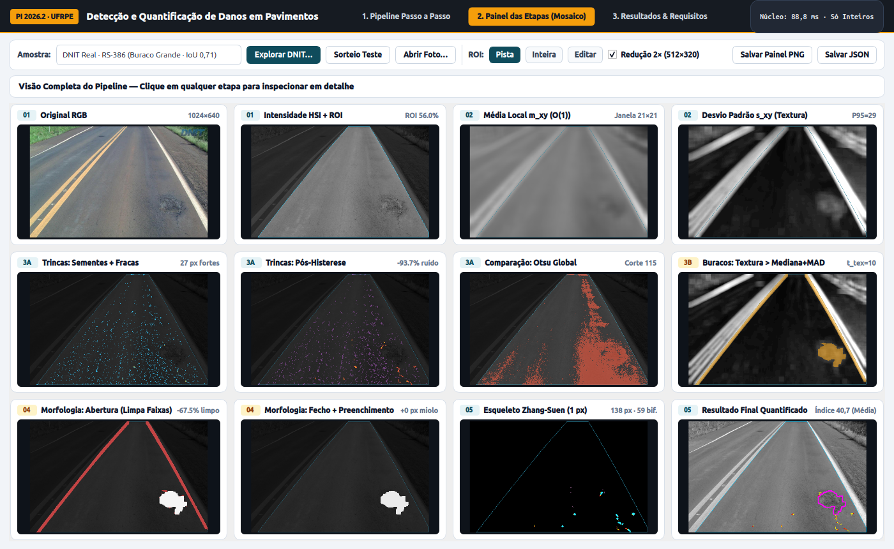
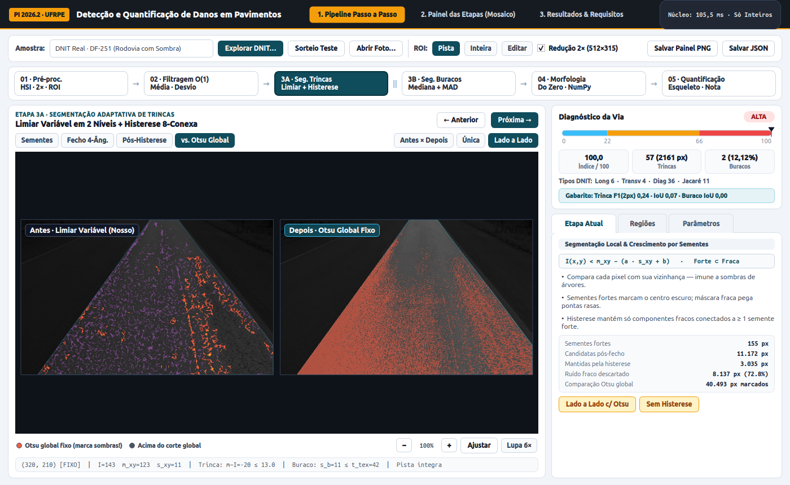

# Sistema de Detecção e Quantificação de Danos em Pavimentos

Projeto da disciplina **Processamento de Imagens (PI 2026.2 — UFRPE)**  
**Professor:** Lucas Fernando da Silva Cambuim  
**Grupo:** Guilherme Henrique, Caio Santos Bispo e Gabriel Lima

> Pipeline clássico **100% determinístico** implementado do zero em **Python + NumPy** com **aritmética exclusivamente inteira** (sem ponto flutuante, sem FFT e sem redes neurais), rodando em ~45 ms por imagem em CPU e acompanhado de **interface gráfica desktop nativa em Python (PyQt5)** para inspeção visual de todas as etapas.

---

## Interface Gráfica em Python

### Pipeline Passo a Passo (`Antes × Depois`, Diagnóstico e Inspetor de Pixel)


### Visão Completa das Etapas (Mosaico Interativo)


### Comparação Lado a Lado — Limiar Variável vs. Otsu Global (`Etapa 3A`)


---

## Tutorial de Execução

### 1. Requisitos e Dependências
Requer **Python 3.10+**. Instale as dependências (`numpy`, `opencv-python` e `PyQt5`):

```bash
pip install -r requirements.txt
```

*(Caso utilize o ambiente virtual local `.venv/`, substitua `python` por `.venv/bin/python` no Linux/macOS ou `.venv\Scripts\python.exe` no Windows.)*

### 2. Abrir a Interface Gráfica Desktop (Recomendado)
```bash
python scripts/interface_visual.py
```
Também é possível abrir diretamente uma foto ou pasta de amostra do dataset DNIT:
```bash
python scripts/interface_visual.py dataset/Dataset/v1/1092481_DF_251_251BDF0052_00028
```
* **Amostras inclusas:** funciona imediatamente mesmo sem o dataset completo (possui exemplos reais e cenários didáticos embutidos, além de botão **Abrir Foto…**). Se `dataset/Dataset/v1/` estiver presente, habilita o **Explorador DNIT** com comparação contra o gabarito humano (`RAW`, `LANE`, `CRACK`, `POTHOLE`).
* **Atalhos rápidos:** setas `←` / `→` ou teclas `1` a `6` alternam entre as etapas do pipeline; roda do mouse aplica zoom na imagem.

### 3. Onde Baixar e Onde Colocar o Dataset DNIT (Opcional)
A interface já funciona imediatamente sem baixar nada (traz exemplos reais e cenários didáticos embutidos, além de **Abrir Foto…**). Para explorar todas as **2.235 imagens reais** e reproduzir as métricas completas:

1. Baixe a base pública **Cracks and Potholes in Road Images** no Mendeley Data:  
   `https://data.mendeley.com/datasets/t576ydh9v8/4`
2. Extraia o arquivo `.zip` interno (`Cracks-and-Potholes-in-Road-Images.zip`) de modo que as pastas das rodovias fiquem dentro de:
   ```text
   cavalo_mola/dataset/Dataset/v1/
   └── 1092481_DF_251_251BDF0052_00028/
       ├── 1092481_DF_251_251BDF0052_00028_RAW.jpg
       ├── 1092481_DF_251_251BDF0052_00028_LANE.png
       ├── 1092481_DF_251_251BDF0052_00028_CRACK.png
       └── 1092481_DF_251_251BDF0052_00028_POTHOLE.png
   ```
   *(Alternativa: se o dataset estiver em outro lugar do disco, basta apontar pela variável de ambiente `CAVALO_DATASET=/caminho/para/v1` ou selecionar a pasta diretamente pelo botão **Explorar DNIT… → Localizar Pasta v1…** na interface.)*

### 4. Processar uma Imagem via Linha de Comando
```bash
python scripts/processar_imagem.py dataset/Dataset/v1/1014586_RS_386_386RS124739_29855
```
Salva em `outputs/exemplos/` o painel com as etapas intermediárias (`.png`) e o relatório quantitativo (`.json`).

### 5. Reproduzir os Experimentos Quantitativos (Base DNIT)
Com o dataset colocado em `dataset/Dataset/v1/` (ou apontado via `CAVALO_DATASET`):
```bash
python scripts/avaliar.py --particao teste
```

### 6. Executar a Suíte de Testes Automatizados
```bash
python -m unittest discover -s tests -v
```

---

## Etapas do Pipeline Implementado

Todo o processamento clássico está em [`src/pavimento/nucleo.py`](src/pavimento/nucleo.py), com mapeamento teórico completo para os slides da disciplina em [`docs/REFERENCIAS.md`](docs/REFERENCIAS.md):

1. **Etapa 01 — Aquisição e Pré-processamento:** conversão RGB → Intensidade **HSI** ($I = \lfloor(R+G+B)/3\rfloor$), **redução espacial 2×** por média `2×2` (`1024×640 → 512×320`) e aplicação da máscara **ROI** da pista.
2. **Etapa 02 — Filtragem Espacial $O(1)$:** somas acumuladas (imagem integral) calculam média local ($m_{xy}$) e desvios padrão locais ($s_{xy}$ para trincas, `raio=10`; $s_b$ para buracos, `raio_buraco=7`).
3. **Etapa 3A — Segmentação de Trincas:** limiarização variável em dois níveis, $I(x,y) < m_{xy} - (a\cdot s_{xy} + b)$, seguida de **histerese por componentes 8-conexos** (preserva pontas conectadas a sementes fortes e descarta ruído isolado).
4. **Etapa 3B — Segmentação de Buracos:** mapa de rugosidade ($s_b$) com limiar robusto extraído do histograma na ROI: $t_{\text{tex}} = \text{Mediana} + k\cdot\text{MAD}$ (`k = 7`).
5. **Etapa 04 — Morfologia Matemática do Zero (NumPy):** erosão, dilatação, **abertura** (remove faixas pintadas no ramo de buracos), **fechamento**, **preenchimento condicional de buracos** e **fechamento direcional em 4 ângulos** (`—`, `|`, `/`, `\`) nas trincas.
6. **Etapa 05 — Esqueleto, Regiões e Quantificação:** rotulagem 8-conexa, filtros geométricos de forma em buracos (área, circularidade $4\pi A/P^2$, razão de aspecto), **esqueletização de Zhang-Suen** (1 px) para medir comprimento, largura média e bifurcações, classificação DNIT (**longitudinal, transversal, diagonal, couro de jacaré**) e cálculo do **Índice de Dano (0–100)** + **Severidade**.

---

## Organização Modular

```text
cavalo_mola/
├── params.json                  # Parâmetros inteiros calibrados no conjunto de treino
├── requirements.txt             # Dependências Python (numpy, opencv-python, PyQt5)
├── src/pavimento/
│   ├── nucleo.py                # Núcleo determinístico completo (aritmética inteira)
│   ├── parametros.py            # Definição e persistência dos parâmetros
│   ├── metricas.py              # Precisão, Revocação, F1, IoU e detecção por imagem
│   ├── dataset.py               # Leitura do dataset DNIT e split determinístico MD5
│   └── visualizacao.py          # Sobreposições e montagem de painéis comparativos
├── interface/
│   ├── app.py                   # Inicialização desktop PyQt5 + saneamento de plugins Qt
│   ├── janela_principal.py      # Janela principal (Pipeline, Mosaico e Resultados)
│   ├── widgets.py               # Canvas Antes×Depois, Lupa 6×, Gauge e Histograma
│   ├── dialogo_dnit.py          # Explorador nativo de amostras reais do DNIT
│   ├── pipeline_didatico.py     # Instrumentação etapa a etapa fiel ao núcleo
│   ├── dados.py                 # Gestão de entradas, presets e relatórios JSON
│   ├── cenarios.py              # Exemplos reais embutidos e cenários sintéticos
│   ├── conteudo.py              # Metadados concisos das etapas e tabelas
│   └── tema.py                  # Folha de estilo QSS e paleta visual
├── scripts/
│   ├── interface_visual.py      # Ponto de entrada da interface gráfica desktop
│   ├── processar_imagem.py      # Processamento de 1 imagem via CLI (PNG + JSON)
│   ├── avaliar.py               # Avaliação oficial nas partições de treino/teste
│   ├── ajustar.py               # Ajuste coordenado restrito ao conjunto de treino
│   └── calibrar_severidade.py   # Calibração inteira dos limiares de severidade
├── docs/REFERENCIAS.md          # Mapeamento técnica → slides da disciplina
└── tests/                       # Testes automatizados do núcleo, ferramentas e GUI
```

---

## Resultados Quantitativos (`666` Imagens Inéditas de Teste)

As **1.451 imagens** avaliadas da base pública **Cracks and Potholes (DNIT)** foram separadas deterministicamente por hash MD5 em **785 imagens de treino** e **666 imagens inéditas de teste**:

| Métrica (Conjunto de Teste — 666 imagens) | Inicial | Calibração (`r=4`) | Final (`r=10`) | Destaque |
| :--- | :---: | :---: | :---: | :--- |
| Trincas — Detecção por imagem (F1) | 0,927 | 0,928 | **0,928** | Revocação de **100,0%** (0 FN) |
| Trincas — Pixel com tol. 2 px (F1) | 0,321 | 0,430 | **0,531** | **+66%** sobre o inicial |
| Trincas — Pixel exato (F1 / IoU) | 0,200 / 0,111 | 0,234 / 0,132 | **0,326 / 0,194** | **+63%** em F1 exato |
| Comprimento de trincas (Spearman) | 0,554 | 0,683 | **0,712** | Forte ordenação relativa |
| Buracos — Detecção por imagem (F1) | 0,330 | 0,380 | **0,380** | Revocação 33,8% → 53,8% |
| Buracos — Pixel (F1 / IoU) | 0,085 / 0,044 | 0,112 / 0,059 | **0,112 / 0,059** | Apenas 0,69% dos pixels |
| Severidade — Acerto exato (4 classes) | 48,5% | 56,3% | **57,4%** | Acaso = 25% |
| Severidade — Erro de até 1 nível | 90,1% | 94,1% | **93,2%** | Triagem consistente |

* **Análise crítica:** o pipeline clássico determinístico obtém ótimo desempenho em trincas, ordenação de comprimento e severidade sem uso de GPU, mas evidencia a limitação natural de descritores locais 2D em buracos (`0,69%` dos pixels da pista, confundidos com remendos, manchas e sombras). Como evolução futura, recomenda-se integrar **CNNs** (contexto semântico) ou **visão estéreo** (profundidade 3D).

---

## Base de Dados e Referências

* **Dataset:** PASSOS, B. T. et al. *Cracks and Potholes in Road Images.* Mendeley Data, v4, 2020. DOI: [`10.17632/t576ydh9v8.4`](https://data.mendeley.com/datasets/t576ydh9v8/4) (CC BY 4.0 — 2.235 imagens reais cedidas pelo DNIT).
* **Norma técnica:** DNIT 005/2003-TER (*Defeitos nos pavimentos flexíveis e semirrígidos*).
* **Fundamentação teórica:** [`docs/REFERENCIAS.md`](docs/REFERENCIAS.md).
