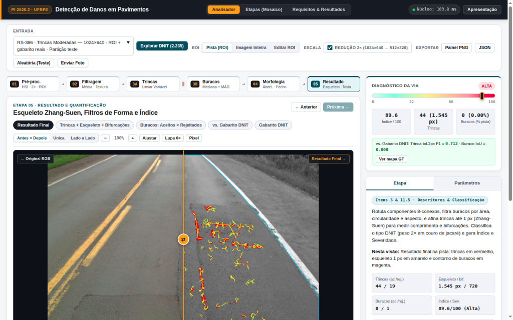
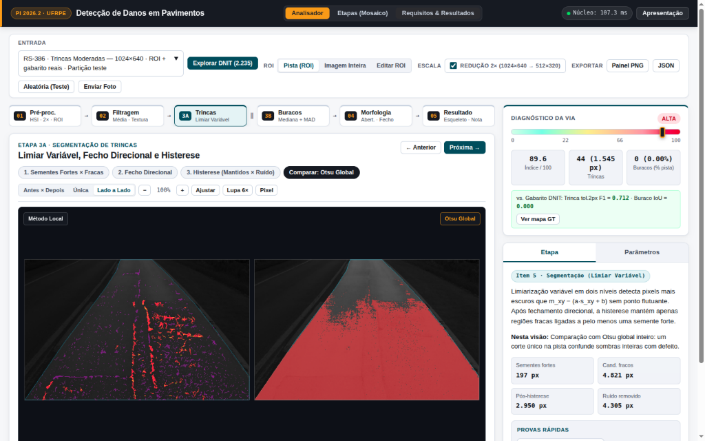
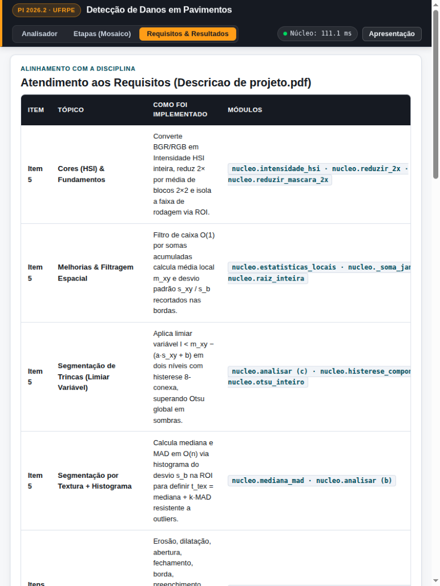

# Sistema de Detecção e Quantificação de Danos em Pavimentos

Projeto da disciplina **Processamento de Imagens (PI 2026.2 — UFRPE)**  
**Professor:** Lucas Fernando da Silva Cambuim  
**Grupo:** Guilherme Henrique, Caio Santos Bispo e Gabriel Lima

> Pipeline clássico **100% determinístico** implementado do zero em **Python + NumPy** usando exclusivamente **aritmética inteira** (sem ponto flutuante, sem FFT e sem redes neurais), rodando em ~45–52 ms por imagem em CPU comum e equipado com uma **interface web interativa** para inspeção etapa por etapa e validação dos requisitos do projeto.

---

## Prévia da Interface Web

A interface web permite ao professor e aos alunos testar imagens reais do DNIT ou fotos próprias, arrastar a cortina **Antes × Depois**, comparar o limiar variável com o Otsu global lado a lado e verificar diretamente cada requisito da disciplina.

### Tela Principal — Analisador na Etapa Final (`Antes × Depois` + Diagnóstico)


### Comparação Lado a Lado — Método Adaptativo Local vs. Otsu Global (`Etapa 3A`)


### Matriz de Requisitos do Projeto & Resultados Oficiais (`666` Imagens de Teste)


---

## Instalação Rápida (1 comando)

O projeto possui um instalador automático em Python puro (`instalar.py`) com wrapper para Linux/macOS (`instalar.sh`). Ele explica no terminal o que está fazendo em cada passo:

1. **Etapa 1/5 — Verificar ambiente:** valida Python `>= 3.10` e integridade dos arquivos essenciais.
2. **Etapa 2/5 — Criar ambiente virtual:** prepara `.venv/` isolado (sem poluir o sistema).
3. **Etapa 3/5 — Instalar dependências:** instala `numpy` e `opencv-python` (`requirements.txt`).
4. **Etapa 4/5 — Configurar dataset DNIT:** verifica `dataset/Dataset/v1/`; se ausente, baixa automaticamente o arquivo oficial da Mendeley Data (`~220 MB`), valida integridade e extrai os dois níveis de `.zip`.
5. **Etapa 5/5 — Validar instalação:** testa as importações do núcleo e executa toda a suíte `unittest`.

### Linux / macOS
```bash
./instalar.sh          # instala tudo, baixa/extrai o dataset e roda os testes
./instalar.sh --abrir  # instala tudo e já abre a interface web no navegador
```

### Windows / Multiplataforma
```bash
python instalar.py
python instalar.py --abrir
```

### Opções úteis do instalador
* `--sem-dataset`: instala apenas o código e as dependências sem baixar os `~220 MB` do dataset DNIT (a interface web continua funcionando com cenários embutidos e upload de fotos).
* `--zip-local CAMINHO`: usa um `.zip` do dataset baixado manualmente (aceita `t576ydh9v8-4.zip` ou `Cracks-and-Potholes-in-Road-Images.zip`).
* `--recriar-venv` / `--forcar-pip` / `--pular-testes`: opções para reinstalação limpa ou validação rápida.

---

## Como Executar

Após rodar o instalador, utilize o Python do ambiente virtual (`.venv/bin/python` no Linux/macOS ou `.venv\Scripts\python.exe` no Windows):

### 1. Abrir a Interface Web Interativa (Recomendado para demonstração)
```bash
.venv/bin/python scripts/interface_visual.py
```
Opções disponíveis: `--porta 8080`, `--host 127.0.0.1`, `--sem-navegador`.

### 2. Processar uma imagem via linha de comando (gera painel de etapas + JSON)
```bash
.venv/bin/python scripts/processar_imagem.py dataset/Dataset/v1/1014586_RS_386_386RS124739_29855
```
Gera em `outputs/exemplos/` o painel visual das etapas e o arquivo `.json` com a quantificação de cada defeito.

### 3. Reproduzir a avaliação oficial nas 666 imagens inéditas de teste
```bash
.venv/bin/python scripts/avaliar.py --particao teste
```

### 4. Executar todos os testes automatizados
```bash
.venv/bin/python -m unittest discover -s tests -v
```

---

## Pipeline Clássico e Requisitos da Disciplina

Cada etapa do núcleo determinístico ([`src/pavimento/nucleo.py`](src/pavimento/nucleo.py)) está mapeada ao material das aulas em [`docs/REFERENCIAS.md`](docs/REFERENCIAS.md):

1. **Aquisição e Pré-processamento:** conversão RGB → Intensidade do modelo **HSI** ($I = \lfloor(R+G+B)/3\rfloor$), **redução espacial 2×** por média de blocos `2×2` (`1024×640 → 512×320`) e recorte pela máscara de pista (**ROI**).
2. **Filtragem Espacial $O(1)$:** filtro de caixa por somas acumuladas calculando média local ($m_{xy}$) e desvio padrão local ($s_{xy}$ / $s_b$) com duas janelas próprias (`raio = 10` para trincas, `raio_buraco = 7` para buracos).
3. **Segmentação em dois ramos paralelos:**
   * **3A — Trincas:** limiarização variável $I < m_{xy} - (a\cdot s_{xy} + b)$ em dois níveis (**sementes fortes** e **candidatos fracos**) com **histerese por componentes conexos** (8-adjacência) — evitando falhas de limiar global como Otsu em trechos com sombra.
   * **3B — Buracos:** mapa de textura ($s_b$) com limiar robusto por histograma ($t_{\text{tex}} = \text{mediana} + k\cdot\text{MAD}$), resistente a faixas pintadas e outliers.
4. **Morfologia Matemática implementada do zero em NumPy:** erosão, dilatação, **abertura** (remove faixas pintadas e riscos finos nos buracos), **fechamento**, **preenchimento condicional de buracos** (fecha miolos lisos com água/poeira) e **fechamento direcional em 4 ângulos** (`—`, `|`, `/`, `\`) nas trincas.
5. **Extração de Características, Esqueleto e Quantificação:** rotulagem 8-conexa, filtros geométricos (área, perímetro morfológico, circularidade $4\pi A/P^2$, razão de aspecto), **esqueletização de Zhang-Suen** (comprimento, largura média = área/comprimento e bifurcações), classificação DNIT (**longitudinal, transversal, diagonal ou couro de jacaré**) e cálculo do **Índice de Dano (0–100)** + **Severidade** (`nenhum`, `baixa`, `media`, `alta`).

---

## Estrutura do Projeto

```text
.
├── instalar.py              # Instalador multiplataforma passo a passo (Python stdlib)
├── instalar.sh              # Atalho executável para Linux/macOS
├── params.json              # Parâmetros inteiros calibrados exclusivamente no treino
├── requirements.txt         # Dependências mínimas (numpy, opencv-python)
├── src/pavimento/
│   ├── nucleo.py            # Núcleo determinístico completo (aritmética inteira)
│   ├── parametros.py        # Definição e carga dos parâmetros inteiros
│   ├── metricas.py          # Precisão, Revocação, F1, IoU e detecção por imagem
│   ├── dataset.py           # Leitura do dataset DNIT e split determinístico por hash
│   └── visualizacao.py      # Montagem de painéis comparativos e sobreposições
├── interface/
│   ├── servidor.py          # Servidor HTTP local em stdlib Python
│   ├── pipeline_didatico.py # Instrumentação etapa a etapa mantendo paridade bit a bit
│   ├── cenarios.py          # Cenários sintéticos determinísticos e exemplos reais
│   └── static/              # Frontend offline (index.html, app.js, didatica.js, styles.css)
├── scripts/
│   ├── interface_visual.py  # Inicializa a interface web local
│   ├── processar_imagem.py  # Gera painel de etapas e JSON para 1 imagem
│   ├── avaliar.py           # Avaliação em treino/teste contra máscaras do dataset
│   ├── ajustar.py           # Busca coordenada restrita ao conjunto de treino
│   └── calibrar_severidade.py # Calibração ótima inteira dos limiares de severidade
├── docs/
│   ├── REFERENCIAS.md       # Mapeamento técnica → slides da disciplina e fontes
│   └── imagens/             # Prints da interface web exibidos neste README
└── tests/                   # Suíte unittest (paridade do núcleo, trincas, buracos, API)
```

---

## Resultados Experimentais (`666` Imagens Inéditas de Teste)

As **1.451 imagens** selecionadas do dataset DNIT foram divididas deterministicamente por hash MD5 do nome em **785 imagens de treino/calibração** e **666 imagens inéditas de teste** (avaliadas ao final).

| Métrica (Conjunto de Teste — 666 imagens) | Inicial | Calibração (`r=4`) | Final (`r=10`) | Observação |
| :--- | :---: | :---: | :---: | :--- |
| Trincas — Detecção por imagem (F1) | 0,927 | 0,928 | **0,928** | Revocação de **100,0%** (0 falsos negativos) |
| Trincas — Pixel com tol. 2 px (F1) | 0,321 | 0,430 | **0,531** | **+66%** sobre o inicial |
| Trincas — Pixel exato (F1 / IoU) | 0,200 / 0,111 | 0,234 / 0,132 | **0,326 / 0,194** | **+63%** em F1 exato |
| Comprimento de trincas (Spearman) | 0,554 | 0,683 | **0,712** | Forte ordenação relativa entre vias |
| Buracos — Detecção por imagem (F1) | 0,330 | 0,380 | **0,380** | Revocação subiu de 33,8% → 53,8% |
| Buracos — Pixel (F1 / IoU) | 0,085 / 0,044 | 0,112 / 0,059 | **0,112 / 0,059** | Buracos = apenas 0,69% dos pixels |
| Severidade — Acerto exato (4 classes) | 48,5% | 56,3% | **57,4%** | Muito acima do acaso (25%) |
| Severidade — Erro de até 1 nível | 90,1% | 94,1% | **93,2%** | Triagem consistente |

### Análise Crítica
* **Pontos fortes:** Núcleo determinístico em inteiros sem GPU, alta sensibilidade na detecção de trincas (F1 por imagem `0,928`), boa correlação na ordenação de comprimento (`0,712` Spearman) e triagem consistente de severidade (`93,2%` até 1 nível).
* **Limitações conhecidas:** Em métodos locais 2D puramente baseados em brilho e textura, buracos (apenas `0,69%` dos pixels da pista, com polígonos manuais aproximados) sofrem confusão visual com remendos, manchas de óleo e sombras recortadas — resultando em IoU pixel baixo (`0,059`). O próximo salto natural seria integrar **CNNs** (contexto semântico) ou **visão estéreo** (profundidade física).

---

## Dataset e Referências

* **Dataset:** PASSOS, B. T. et al. *Cracks and Potholes in Road Images.* Mendeley Data, v4, 2020. DOI: [`10.17632/t576ydh9v8.4`](https://data.mendeley.com/datasets/t576ydh9v8/4) (Licença CC BY 4.0 — 2.235 imagens reais de rodovias do ES, RS e DF cedidas pelo DNIT).
* **Terminologia de defeitos:** Norma DNIT 005/2003-TER (*Defeitos nos pavimentos flexíveis e semirrígidos*).
* **Mapeamento teórico detalhado:** veja [`docs/REFERENCIAS.md`](docs/REFERENCIAS.md).
